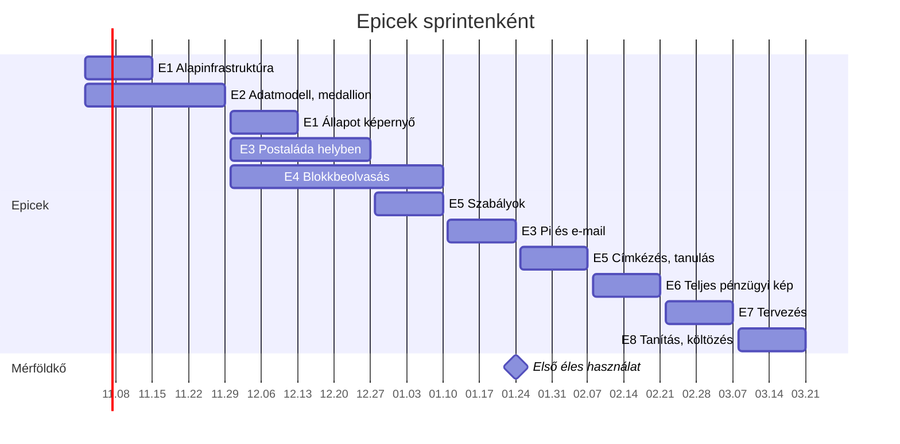

# Fejlesztési terv

8 epic, 10 kéthetes sprint, kb. 183 story pont. Minden story egy feladat: a 📅 dátum a sprint vége, a címkék az epicet és a sprintet jelölik. A [Tasks](https://publish.obsidian.md/tasks/) bővítménnyel szűrhető, pl. `tags include #sprint/S1`.

Részletes sprintterv: [[Sprint 1]] · [[Sprint 2]] · [[Sprint 3]] · [[Sprint 4]] · Kapcsolódó: [[Üzleti koncepció]] · [[Technikai terv]] · [[Release folyamat]] · [[Változásnapló]]

## Sprintek

| Sprint | Kezdet | Vég |
| --- | --- | --- |
| S1 | 2026-11-02 | 2026-11-15 |
| S2 | 2026-11-16 | 2026-11-29 |
| S3 | 2026-11-30 | 2026-12-13 |
| S4 | 2026-12-14 | 2026-12-27 |
| S5 | 2026-12-28 | 2027-01-10 |
| S6 | 2027-01-11 | 2027-01-24 |
| S7 | 2027-01-25 | 2027-02-07 |
| S8 | 2027-02-08 | 2027-02-21 |
| S9 | 2027-02-22 | 2027-03-07 |
| S10 | 2027-03-08 | 2027-03-21 |

Első éles használat: a 6. sprint vége (2027-01-24), amikor működik a blokkbeolvasás és a telefonos feltöltés. Addig a rendszer a laptopon fut, mock adattal és néhány saját próbablokkal, és az éles használat előtt a `finance` adatbázis üresen újraépül (FIN-309). A sorrend indoka: [[0006-blokkbeolvasas-a-pi-elott|ADR 0006]].

## FIN-E1 Alapinfrastruktúra (S1, S3, 17 SP)

Kész, ha: az otthoni Compose fut, az adat megmarad és mentődik, az állapota pedig egy weboldalon látszik.

- [ ] FIN-101 Git repo mappákkal (pi, home, worker, dbt) és README · 2 SP #E1 #sprint/S1 📅 2026-11-15
    - Elfogadás: klónozás után a `docker compose up` elindul
- [ ] FIN-102 Otthoni Compose: Postgres, Garage, Metabase, minden adat egy mappában, beállítások `.env`-ben · 3 SP #E1 #sprint/S1 📅 2026-11-15
    - Elfogadás: újraindítás után minden adat megmarad
- [ ] FIN-103 A Metabase saját beállításai a Postgresben · 1 SP #E1 #sprint/S1 📅 2026-11-15
    - Elfogadás: a Metabase-konténer törlése után a dashboardok megmaradnak
- [ ] FIN-104 Napi mentés: adatbázis-dump és Garage-szinkron külső meghajtóra · 3 SP #E1 #sprint/S1 📅 2026-11-15
    - Elfogadás: egy visszaállítási próba sikeres
- [ ] FIN-105 CI: lint, migrációk és Compose-ellenőrzés minden pushra · 3 SP #E1 #sprint/S1 📅 2026-11-15
    - Elfogadás: hibás migrációnál a CI piros; a dbt lépés a 2. sprinttől kapcsol be
- [ ] FIN-106 Állapot képernyő: a stack részei, a feldolgozás és az ütemezett futások egy weboldalon · 5 SP #E1 #sprint/S3 📅 2026-12-13
    - Elfogadás: egy leállított szolgáltatás 30 másodpercen belül hibaként látszik, az elavult adat soha nem zöld

## FIN-E2 Adatmodell és medallion alap (S1–S2, 14 SP)

Kész, ha: kézi bejegyzésből gold mutató és Áttekintés dashboard lesz.

- [ ] FIN-201 Bronz sémák: nyers dokumentum, modellkimenet, kézi bejegyzés; módosítás és törlés tiltva · 3 SP #E2 #sprint/S1 📅 2026-11-15
    - Elfogadás: egy UPDATE-kísérlet hibát ad
- [ ] FIN-202 dbt projekt, források, első silver: egységes tranzakció · 3 SP #E2 #sprint/S2 📅 2026-11-29
    - Elfogadás: `dbt build` zöld, a tesztek futnak
- [ ] FIN-203 Kézi bejegyzés API a bronzba · 3 SP #E2 #sprint/S2 📅 2026-11-29
    - Elfogadás: a felvitt tétel a következő futás után megjelenik a silverben
- [ ] FIN-204 Gold: havi cash-flow és kategória-hónap · 3 SP #E2 #sprint/S2 📅 2026-11-29
    - Elfogadás: három mintahónapon egyezik a kézi számolással
- [ ] FIN-205 Metabase Áttekintés dashboard · 2 SP #E2 #sprint/S2 📅 2026-11-29
    - Elfogadás: ez a hónap, az előző és az átlag egy képernyőn látszik

## FIN-E3 Postaláda, Pi és e-mail (S3–S4, S6, 36 SP)

Kész, ha: telefonról feltöltött vagy e-mailben továbbított számla eljut az otthoni object store-ba.

- [ ] FIN-301 Tailscale a Pi-n, a telefonokon és az otthoni gépen · 2 SP #E3 #sprint/S6 📅 2027-01-24
    - Elfogadás: a webapp csak a Tailscale-hálózatról érhető el
- [ ] FIN-302 Caddy HTTPS a saját domainen, DNS-alapú tanúsítvány · 2 SP #E3 #sprint/S6 📅 2027-01-24
    - Elfogadás: érvényes tanúsítvány, a böngésző nem figyelmeztet
- [ ] FIN-303 Authelia TOTP 2FA két felhasználóval · 3 SP #E3 #sprint/S6 📅 2027-01-24
    - Elfogadás: második faktor nélkül nincs hozzáférés
- [ ] FIN-304 PWA feltöltés: fotó, ki vásárolt, a blokk dátuma, több címke; a feltöltés ideje automatikus · 5 SP #E3 #sprint/S3 📅 2026-12-13
    - Elfogadás: böngészőből egy képernyőn feltölthető; telefonról a FIN-308 után
- [ ] FIN-305 Postaláda API a workernek: új tételek, letöltés, lezárás, törlés lezárás után · 3 SP #E3 #sprint/S3 📅 2026-12-13
    - Elfogadás: a lezárt kép eltűnik a postaládából
- [ ] FIN-306 Worker: lehúzás a Garage-ba, hash alapú duplikációszűrés, bronz rekord · 5 SP #E3 #sprint/S3 📅 2026-12-13
    - Elfogadás: kétszer feltöltött kép egyszer kerül be
- [ ] FIN-307 E-mailes számlafogadás: külön postafiók, IMAP-lehúzás, csak a két saját feladótól, címkék a tárgyból, a levél és a mellékletek a Garage-ba · 5 SP #E3 #sprint/S6 📅 2027-01-24
    - Elfogadás: továbbított PDF-számla bekerül a bronzba; idegen feladó levele nem
- [ ] FIN-308 Webapp és postaláda költözése a Pi-re: `pi/` Compose, Caddy és Authelia mögött · 3 SP #E3 #sprint/S6 📅 2027-01-24
    - Elfogadás: telefonról feltölthető, a worker a Pi postaládájából húz
- [ ] FIN-309 A `finance` adatbázis üres újraépítése az első éles használat előtt · 1 SP #E3 #sprint/S6 📅 2027-01-24
    - Elfogadás: a bronz és a Garage `raw` bucket üres, a mock adat és a próbablokkok eltűntek a restic-pillanatképekből is, a Metabase dashboardjai megmaradnak
- [ ] FIN-310 Tömeges feltöltés: több blokk egyszerre, közös adatokkal · 2 SP #E3 #sprint/S4 📅 2026-12-27
    - Elfogadás: 12 kép egy mozdulattal feltölthető, egy rossz fájl a többit nem állítja meg
- [ ] FIN-311 Több képből álló hosszú blokk feltöltése és összefűzése · 5 SP #E3 #sprint/S4 📅 2026-12-27
    - Elfogadás: egy kétképes blokkból egy blokk lesz egy végösszeggel, a közös sorok egyszer számítanak

## FIN-E4 Blokkbeolvasás (S3–S5, 38 SP)

Kész, ha: a blokkból tétel szintű silver lesz, kivételnél ellenőrzéssel. A FIN-403 csak akkor kell, ha a FIN-410 mérése szerint a szöveges olvasat hibái miatt túl sok blokk kerül ellenőrzésre.

- [ ] FIN-401 Ollama és GLM-OCR a Compose-ban, egyelőre a laptop CPU-ján · 2 SP #E4 #sprint/S3 📅 2026-12-13
    - Elfogadás: egy mintablokkra JSON jön vissza
- [ ] FIN-402 Szabályalapú blokkfeldolgozó a szöveges olvasatra, a JSON-olvasat kivezetése · 5 SP #E4 #sprint/S4 📅 2026-12-27
    - Elfogadás: a kitalált mintablokkokon a tételek és az összegek pontosak, és a feldolgozó modell nélkül újrafuttatható
- [ ] FIN-403 PaddleOCR második olvasat bizonytalan esetekre, feltételes · 3 SP #E4 #sprint/S5 📅 2027-01-10
    - Elfogadás: bizonytalan blokknál az OCR-szöveg is a bronzba kerül
- [ ] FIN-404 Automatikus ellenőrzés: összeg, tételszorzat, fizetés, dátum, ismételt blokk · 5 SP #E4 #sprint/S4 📅 2026-12-27
    - Elfogadás: eltérésnél a blokk az ellenőrzési sorba kerül, és az állapotoldalon sem „rendben”
- [ ] FIN-405 Javaslat visszatöltése a postaládába, kivétel alapú Ellenőrzés képernyő · 5 SP #E4 #sprint/S5 📅 2027-01-10
    - Elfogadás: böngészőből javítható, a döntés eljut a bronzba; telefonról a FIN-308 után
- [ ] FIN-406 Silver tétel szint: blokk, blokktétel, bolt-egységesítés, korrekciós tábla · 5 SP #E4 #sprint/S5 📅 2027-01-10
    - Elfogadás: javítás után a silver a javított értéket mutatja, a bronz változatlan
- [ ] FIN-407 Mérés 20–30 saját blokkon · 2 SP #E4 #sprint/S5 📅 2027-01-10
    - Elfogadás: a mezőnkénti pontosság le van írva
- [ ] FIN-408 Kiolvasás a workerben: GLM-OCR hívás, nyers eredmény és modellverzió a bronzba · 3 SP #E4 #sprint/S3 📅 2026-12-13
    - Elfogadás: egy feltöltött blokk kiolvasása a `bronze.extraction` táblába kerül, modellverzióval
- [ ] FIN-409 DRS-betétdíj külön vezetése: várható összeg, kézi állítás és nullázás · 3 SP #E4 #sprint/S5 📅 2027-01-10
    - Elfogadás: a betétdíj nincs a kiadások között, a várható összeg látszik, nullázás után 0, a bronz változatlan
- [ ] FIN-410 Mérés 5–10 saját blokkon, legalább 3 boltból · 2 SP #E4 #sprint/S4 📅 2026-12-27
    - Elfogadás: a mezőnkénti pontosság le van írva, és a FIN-403-ról döntés született
- [ ] FIN-411 Visszaváltási bizonylat feltöltése és az utalványsor párosítása · 3 SP #E4 #sprint/S5 📅 2027-01-10
    - Elfogadás: a feltöltött bizonylat csökkenti a várható betétdíjat, és a hozzá tartozó utalványsor nem csökkenti másodszor

## FIN-E5 Címkézés és tanulás (S5, S7, 21 SP)

Kész, ha: a címkék előre kitöltve jönnek, a pontosság mérve van.

- [ ] FIN-501 Címke- és boltszabályok tárolása és alkalmazása a silverben · 3 SP #E5 #sprint/S5 📅 2027-01-10
    - Elfogadás: szabályra illeszkedő tétel automatikusan címkét kap
- [ ] FIN-502 Tételek besorolása a blokk címkéi közül, bizonytalannál kérdés · 5 SP #E5 #sprint/S7 📅 2027-02-07
    - Elfogadás: tétel csak a blokkon megadott címkét kaphatja
- [ ] FIN-503 Szövegosztályozó tételnévből és boltból, éjszakai újratanítással · 5 SP #E5 #sprint/S7 📅 2027-02-07
    - Elfogadás: a tesztkészleten mért pontosság bekerül a goldba
- [ ] FIN-504 Előre kitöltött címkék feltöltéskor · 3 SP #E5 #sprint/S7 📅 2027-02-07
    - Elfogadás: ismert boltnál a javasolt címkék megjelennek
- [ ] FIN-505 Modellpontosság gold tábla és dashboard · 3 SP #E5 #sprint/S7 📅 2027-02-07
    - Elfogadás: a javítási arány boltonként és mezőnként látszik
- [ ] FIN-506 Tesztkészlet félrerakása a jóváhagyott blokkokból · 2 SP #E5 #sprint/S7 📅 2027-02-07
    - Elfogadás: a tesztkészlet blokkjai nem kerülnek tanításba

## FIN-E6 Teljes pénzügyi kép (S8, 19 SP)

Kész, ha: bérpapír, kivonat, hitelek, közös kártya és a személyes fülek működnek.

- [ ] FIN-601 Bérpapír PDF feltöltése, a nettó összeg kinyerése és megerősítése · 5 SP #E6 #sprint/S8 📅 2027-02-21
    - Elfogadás: a bevétel személyenként megjelenik a silverben
- [ ] FIN-602 Kivonat kézi rögzítése vagy beillesztése, párosítás a blokkokkal · 5 SP #E6 #sprint/S8 📅 2027-02-21
    - Elfogadás: blokk és a hozzá tartozó banki tétel nem duplikálódik
- [ ] FIN-603 Hitelek és egyéb tartozások felvitele, törlesztések · 3 SP #E6 #sprint/S8 📅 2027-02-21
    - Elfogadás: a hátralévő tartozás a goldban látszik
- [ ] FIN-604 Közös kártya és Revolut-zseb kezelése átvezetésként · 3 SP #E6 #sprint/S8 📅 2027-02-21
    - Elfogadás: az átvezetés nem jelenik meg kiadásként
- [ ] FIN-605 Közös háztartás és két Személyes dashboard · 3 SP #E6 #sprint/S8 📅 2027-02-21
    - Elfogadás: mindketten látják mindhárom fület

## FIN-E7 Tervezés (S9, 17 SP)

Kész, ha: célok, what-if és javasolt utalás látszik a Metabase-ben.

- [ ] FIN-701 Célok kezelése a webappban, a Revolut-zseb egyenlegével · 3 SP #E7 #sprint/S9 📅 2027-03-07
    - Elfogadás: minden cél állása látszik
- [ ] FIN-702 Szükséges havi összeg és megvalósíthatóság a szabad keret alapján · 3 SP #E7 #sprint/S9 📅 2027-03-07
    - Elfogadás: a dashboard jelzi, ha egy cél nem fér bele
- [ ] FIN-703 What-if paraméterek a Metabase-ben · 3 SP #E7 #sprint/S9 📅 2027-03-07
    - Elfogadás: az étterem 20%-os csökkentésére új céldátum jelenik meg
- [ ] FIN-704 Javasolt utalás a közös kártyára, 50/50 · 3 SP #E7 #sprint/S9 📅 2027-03-07
    - Elfogadás: a javaslat fejenkénti összeggel jelenik meg
- [ ] FIN-705 Előrejelzés a jövő hónapra · 3 SP #E7 #sprint/S9 📅 2027-03-07
    - Elfogadás: a várható kiadás az ismétlődő tételekből és mintákból látszik
- [ ] FIN-706 Költségkeret fül kategóriánkénti limittel · 2 SP #E7 #sprint/S9 📅 2027-03-07
    - Elfogadás: limit közelében jelzés jelenik meg

## FIN-E8 Tanítás és költözés (S10, 21 SP)

Kész, ha: a modell a Proxmoxon fut, a számok egyeznek. A FIN-801–804 csak akkor kell, ha a FIN-407 mérése szerint a GLM-OCR a saját blokkokon nem elég jó.

- [ ] FIN-801 Tanítási adatkészlet a Garage-ban: manifest a képekről és a javított címkékről · 3 SP #E8 #sprint/S10 📅 2027-03-21
    - Elfogadás: a verziózott manifest a Garage `datasets/` mappájában van, a tesztkészlet nélkül
- [ ] FIN-802 A 4B-s Qwen3-VL LoRA-finomhangolása Unslothtal a főgépen · 5 SP #E8 #sprint/S10 📅 2027-03-21
    - Elfogadás: a tanítás lefut, a modell betölthető
- [ ] FIN-803 Kiértékelés: alapmodell és finomhangolt a tesztkészleten · 3 SP #E8 #sprint/S10 📅 2027-03-21
    - Elfogadás: csak jobb eredménynél történik csere
- [ ] FIN-804 GGUF-export a Garage `models/` mappájába és Ollama Modelfile · 2 SP #E8 #sprint/S10 📅 2027-03-21
    - Elfogadás: az Ollama a Garage-ból tölti be, és hívható
- [ ] FIN-805 Proxmox VM GPU-átadással és Dockerrel · 3 SP #E8 #sprint/S10 📅 2027-03-21
    - Elfogadás: a konténer látja a 1660 Ti-t
- [ ] FIN-806 Költözés a Technikai terv lépései szerint · 5 SP #E8 #sprint/S10 📅 2027-03-21
    - Elfogadás: a gold összegei egyeznek a régi helyen mértekkel

## Munkaszabályok

**Definition of Done**

- A kód pull requestben van, és a merge előtt a teljes diff át van nézve.
- A `dbt build` és a tesztek zöldek a CI-ban.
- A README vagy egy döntési jegyzet (ADR) frissítve, ha a működés változott.
- A változás bekerült a [[Változásnapló]] Kiadatlan részébe.
- Saját, valós adaton ki van próbálva.

**Ritmus:** sprinttervezés kb. 30 perc, heti áttekintés kb. 15 perc, sprint végén demó és retró kb. 30 perc, utána kiadás a [[Release folyamat]] szerint.

**Jelölések:** FIN-E1…E8 az epicek, FIN-101… a story-k (az első számjegy az epic). Story pont Fibonacci-skálán (1, 2, 3, 5, 8); ami 8 fölé menne, azt bontani kell.
