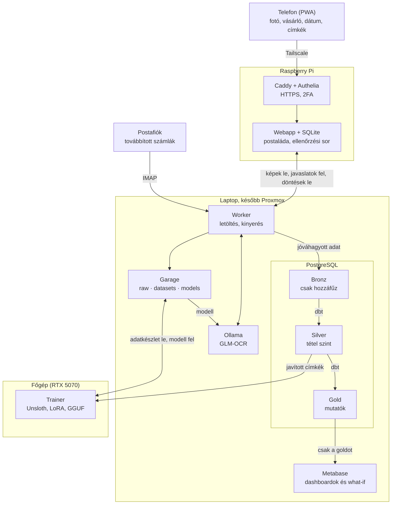

# Technikai terv

Kapcsolódó: [[Üzleti koncepció]] · [[Fejlesztési terv]] · [[Sprint 1]]

## Architektúra

A teljes rendszer nyílt forrású eszközökből áll: a Raspberry Pi a kapu, a feldolgozás otthon, Docker Compose-ban fut.

A telefon Tailscale-en és 2FA-val csak a Pi-t éri el; az e-mailben továbbított számlákat a worker IMAP-pal húzza le egy külön postafiókból. Az otthoni worker lehúzza a képeket a Garage-ba, a modellel javaslatot készít, visszaküldi jóváhagyásra, majd a jóváhagyott adatot a bronzba írja. Onnan a dbt építi a silvert és a goldot, amelyet a Metabase olvas. A tanítás a főgépen fut: az adatkészletet a Garage-ból veszi, a kész modellt oda teszi vissza, és az Ollama onnan tölti be. Minden kapcsolatot az otthoni oldal nyit.

## Futtatási környezet

A rendszer két részből áll: a mindig bekapcsolt Raspberry Pi a kapu és a postaláda, az otthoni stack pedig Docker Compose-ban végzi a feldolgozást. A stack most a laptopon fut, később átköltözik a Proxmoxra.

| Gép | Szerep | GPU |
| --- | --- | --- |
| Raspberry Pi | Kapu: Tailscale, HTTPS, 2FA, webapp, átmeneti tárolás | Nincs, nem kell |
| Laptop (átmeneti) | Most a teljes stack és a modellek, CPU-n | Nincs külön GPU, 30 GB memória |
| Főgép | A modell tanítása | RTX 5070, 12 GB |
| Proxmox (végleges hely) | A stack és a tanított modell futtatása, VM-ben GPU-átadással | GTX 1660 Ti, 6 GB |

Mentés: naponta adatbázis-dump és az object store szinkronja külső meghajtóra (pl. restic-kel).

## Adatfelvétel: webapp a Pi-n és e-mail

A webapp a Pi-n fut, a telefonon PWA-ként jelenik meg, és eléri a kamerát. Amíg a Pi nincs beállítva, átmenetileg az otthoni stackben fut, csak helyben elérhetően ([[0005-monorepo-es-atmeneti-otthoni-webapp|ADR 0005]]). A backend Python (FastAPI, MIT licenc), a függő tételeket egy kis SQLite tárolja. A Pi csak postaláda: amit az otthoni stack lezárt, azt törli.

| Képernyő | Mit csinál |
| --- | --- |
| Fotó | Blokk lefotózása, mellé: ki vásárolt (alapból a feltöltő), a blokkon szereplő dátum, és egy vagy több címke (pl. élelmiszer + háztartás). A feltöltés időbélyege automatikus |
| Ellenőrzés | Csak kivételeknél: ha a tételek összege nem egyezik a végösszeggel, ha a beírt és a beolvasott dátum eltér, vagy ha egy tétel címkéje nem egyértelmű |
| Kézi bejegyzés | Blokk nélküli kiadás vagy bevétel |
| Bérpapír | Elektronikus bérpapír (PDF) feltöltése, a nettó összeg megerősítése |
| Kivonat | Banki kivonat sorainak kézi rögzítése vagy beillesztése |
| Hitelek és tartozások | Hitelek, egyéb tartozások és törlesztések |
| Célok | Célok, határidők, Revolut-zseb egyenlege |

### Biztonságos elérés

Ajánlás: a már meglévő Tailscale és egy 2FA együtt, mert blokkokról, bérpapírokról és tartozásokról van szó.

- **Tailscale:** a telefon, a Pi és az otthoni gép egy privát hálózatban van, a webapp kívülről nem látszik, és nem kell portot nyitni. A worker is ezen éri el a Pi-t.
- **Ha teljesen nyílt forrás kell:** a Tailscale kliensei nyíltak, de a vezérlőszervere nem ([forrás](https://github.com/trigram-dev/headscale)). Helyette a Headscale, a vezérlőszerver nyílt implementációja futhat a Pi-n. Ehhez viszont a Headscale-nek kívülről elérhetőnek kell lennie a domaineden.
- **Caddy reverse proxy:** HTTPS a saját domaineden; a tanúsítvány DNS-alapú ellenőrzéssel akkor is megvan, ha az oldal csak a Tailscale-hálózaton látszik.
- **Authelia:** kétfaktoros belépés (TOTP) a webapp előtt, két felhasználóval. Így egy elveszett, de a hálózatba belépett telefon sem elég a hozzáféréshez.

### Kapcsolat az otthoni stackkel

Minden kapcsolatot az otthoni oldal nyit a Pi felé, így az otthoni hálózatba nem kell bejövő portot nyitni. Ha a gép ki van kapcsolva, a Pi addig gyűjti a képeket. Amíg a Pi nincs beállítva, a postaláda szerepét az otthoni webapp viszi ugyanazzal az API-val, így a worker a költözéskor csak másik címre mutat ([[0006-blokkbeolvasas-a-pi-elott|ADR 0006]]).

1. Az otthoni worker letölti az új képeket a Pi-ről az object store-ba.
2. A modell feldolgozza őket, a worker visszatölti a javaslatot a Pi ellenőrzési sorába.
3. A telefonon jóváhagyod vagy javítod, a worker letölti a döntést a bronzba.
4. A Pi törli a lezárt tételt.

### E-mailben továbbított számlák

A webshopok és szolgáltatók számláit egy külön postafiókba lehet továbbítani, pl. egy `szamla@` címre a saját domainen. Ajánlott a meglévő levelezőszolgáltatónál létrehozni, mert saját levelezőszerver üzemeltetése sok munka, és otthoni internetről a 25-ös portot gyakran blokkolják.

- **Lehúzás, mint a Pi-nél:** a worker IMAP-pal, titkosított kapcsolaton olvassa a postafiókot; a kapcsolatot itt is az otthoni oldal nyitja. A feldolgozott levél egy „Feldolgozva” mappába kerül, nem törlődik.
- **Csak ismert feladótól:** kizárólag a két saját címünkről továbbított levél kerül be, és a levél hitelesítési fejléce (SPF, DKIM) is ellenőrzött. Így egy idegen levél nem tud hamis kiadást becsempészni.
- **Ugyanazok a mezők, mint feltöltéskor:** a vásárló alapból a továbbító; a címkék a tárgyból jönnek, pl. `#élelmiszer #háztartás`; a dátumot a modell olvassa ki a számláról.
- **Bronz:** a teljes nyers levél (.eml) és a mellékletek a Garage-ba kerülnek, a bronzban `email` forrástípussal.
- **PDF-számlák:** szöveges PDF-nél a szövegréteg közvetlenül kiolvasható, ez gyorsabb és pontosabb; a képfelismerő modell csak szkennelt PDF-nél és képnél kell.
- **Későbbre:** a csak letöltési linket tartalmazó számlaértesítők kezelése nem része az első változatnak.

## OCR, címkézés és tanítás

A blokkfotóból egy helyben futó képfelismerő nyelvi modell közvetlenül strukturált JSON-t készít: bolt, dátum, tételek, végösszeg, fizetési mód. Semmi nem megy ki külső szolgáltatáshoz.

- **Alapmodell:** [Ollama](https://ollama.com/library/glm-ocr) + [GLM-OCR](https://huggingface.co/zai-org/GLM-OCR). MIT licencű, betanítás nélkül használható, és JSON-séma alapján nyer ki adatot. Két kitalált blokkon a laptop CPU-ján kb. 17 másodperc alatt futott, és a szóközös ezres tagolást is jól olvasta (2026-10-31). Fotószerű, 1400 pixelre kicsinyített képen egy olvasat kb. 80 másodperc, és a worker kettőt készít: a JSON adja a szerkezetet, a szöveges olvasat a megbízhatóbb értékeket ([[0007-ket-olvasat-1400-pixelen|ADR 0007]]). A leírása a magyart nem említi, ezért saját blokkokon kell mérni.
- **Tartalékmodell:** [Qwen3-VL](https://ollama.com/library/qwen3-vl), Apache 2.0 licenccel. A 4B-s változat ugyanott 56 másodperc alatt futott, az ezres tagolást elrontotta, és a válasz elejét a hívásnak kell megadnia, mert különben a kimeneti korlátig gondolkodik. Erre akkor váltunk, ha a GLM-OCR a saját blokkokon gyenge. A részletek: [[Sprint 3]].
- **Tanítás a főgépen, futtatás a kis gépen:** csak akkor kell, ha az alapmodell a saját blokkokon nem elég jó. A 8B-s változat kb. 6 GB ([forrás](https://www.agenticwire.news/article/ollama-qwen)), így a 1660 Ti 6 GB-jába nem fér el teljesen. Ezért a 4B-s változatot finomhangoljuk a főgépen a jóváhagyott blokkokon (LoRA, pl. [Unsloth](https://unsloth.ai/docs/de/modelle/tutorials/qwen3-how-to-run-and-fine-tune/qwen3-vl-how-to-run-and-fine-tune), amely támogatja a Qwen3-VL-t), majd GGUF-ként a Garage `models/` mappájába kerül, és a Proxmox Ollamája onnan tölti be. Az adatkészlet is a Garage-ban él (`datasets/`): egy manifest köti össze a `raw/` alatti képeket a Postgresben lévő javított címkékkel, így minden modellverzióról tudni, min tanult. Tanítás előtt egyszer a főgép helyi SSD-jére szinkronizálódik, mert a tanítás sokszor végigolvassa.
- **Második olvasat:** [PaddleOCR](https://www.paddleocr.ai/v3.1.1/en/version3.x/algorithm/PP-OCRv5/PP-OCRv5_multi_languages.html), amely támogatja a magyart. Ha a modell bizonytalan, a nyers OCR-szöveg segít ellenőrizni.
- **Automatikus ellenőrzés:** a tételek összege egyezzen a végösszeggel, a beolvasott dátum a feltöltéskor beírttal. Ha nem, a blokk az Ellenőrzés képernyőre kerül.
- **Miért kell a tanítás:** egy mérésben egy hasonló, nem finomhangolt helyi modell ([qwen2.5-VL 7B](https://github.com/Yacine-ai-tech/DocIntel)) a telefonnal fotózott blokkok 77%-át olvasta be hibátlanul. A magyar blokkokon finomhangolt modell ennél jobb lehet, de ezt mérni kell.
- **Saját tesztkészlet:** a jóváhagyott blokkok egy része félrerakva tesztkészlet. Minden új modellt ezen mérünk, mielőtt a régit leváltja.
- **Újrafeldolgozhatóság:** a modell kimenete a modell nevével és verziójával kerül a bronzba, így jobb modellel a régi blokkok újra feldolgozhatók.

Első lépésként 20–30 saját blokkon érdemes kipróbálni, mert a magyar rövidítéseket és ékezeteket a gyakorlat mutatja meg.

### Címkék és tanulás

A blokk beolvasása és a címkék kitalálása két külön feladat, mert egészen más a súlyuk.

| Feladat | Ki tanulja | Hol és mikor |
| --- | --- | --- |
| Blokk beolvasása: bolt, dátum, tételek, árak | GLM-OCR, szükség esetén finomhangolt Qwen3-VL | Most a laptop CPU-ján, tanítás csak szükség esetén a főgépen |
| Címkék és kategóriák javaslata | Szabályok plusz egy kis szövegosztályozó a tételnevekből és a boltból | CPU-n, éjjelente újratanítva, minden feltöltésből tanul |

- **A címke a blokkra vonatkozik, nem a tételre:** az „élelmiszer + háztartás” azt mondja meg, mi van a blokkon, de azt nem, melyik tétel melyik. A rendszer ezért a tételeket csak a megadott címkék közül sorolja be, és ahol nem egyértelmű, ott rákérdez. Így a blokkszintű címkékből tétel szintű tudás lesz.
- **Cél: a címkézés elhagyása.** Ha egy boltnál a javaslatok tartósan helyesek, a feltöltéskor már a javasolt címkék jelennek meg előre kitöltve; elég jóváhagyni, idővel pedig a jóváhagyás is elhagyható.
- **Ki vásárolt:** alapból a feltöltő, ezt nem érdemes jósolni.

## Tárolás és a medallion rétegek

Egy PostgreSQL adatbázis három sémával (bronze, silver, gold), mellette a nyers fájlok egy fájltárban.

- **Object store a nyers fájloknak:** [Garage](https://garagehq.deuxfleurs.fr/) (AGPLv3), egy csomópontos, S3-kompatibilis store, három mappával: `raw/` (nyers fájlok), `datasets/` (tanítási adatkészletek), `models/` (modellek). Költözéskor rclone-nal egy lépésben átszinkronizálható. A MinIO-t nem javaslom: a közösségi kiadás 2025 októberétől nem kap Docker image-et, 2026-ban a repót archiválták ([forrás](https://itsfoss.com/news/minio-moves-away-from-open-source/)).
- **Bronz csak hozzáfűz:** soha nincs UPDATE vagy DELETE. A javítás a silverben, külön korrekciós táblában történik.
- **Szabályok:** a kategória- és boltszabályokat a jóváhagyások hozzák létre; a worker a Pi-ről a bronzba hozza őket, a silver forrásként olvassa.

| Réteg | Fő táblák | Jelleg |
| --- | --- | --- |
| Bronz | nyers dokumentum (fájl, hash, feltöltő, vásárló, időpontok, forrástípus), modellkimenet (JSON + modellverzió), kézi bejegyzés, bérpapír, kivonatsor, hitel- és tartozásbejegyzés | Csak hozzáfűz, változatlan |
| Silver | blokk, blokktétel, egységes tranzakció (kiadás, bevétel, átvezetés), bolt, kategória, fizető fél, korrekció, hitel, tartozás | Tisztított, deduplikált, szabályokkal kategorizált |
| Gold | havi cash-flow (közös és személyes), kategória-hónap, közös kassza (befizetés, kiadás, javasolt utalás), célok állása, hitelek állása, tételár-történet, modellpontosság | Kész mutatók a BI-nak |

## Transzformáció és ütemezés

A silver és a gold táblákat dbt Core építi a bronzból, SQL-modellekkel és tesztekkel.

- **Verzió:** a stabil 1.x vonalat használjuk a Postgres-adapterrel (`dbt-core` 1.12.6, `dbt-postgres` 1.11.0). Az új telepítésekhez már a dbt v2 az alap, de a frissítési útmutató a támogatott adapterek között nem sorolja fel a Postgrest, és az alapértelmezett csomag saját licenccel jön; az Apache 2.0 licencű változat a `dbt-oss` (2026-10-31, [forrás](https://docs.getdbt.com/docs/dbt-versions/dbt-upgrade/upgrading-to-v2)). Az 1.x továbbra is támogatott.
- **Könnyebb kezdés:** ha gyorsan látni akarsz valamit, indulhat sima Postgres-nézetekkel és materializált nézetekkel, amelyeket egy rövid script frissít. Az SQL később változatlanul átemelhető dbt-modellekbe.
- **Tesztek:** a tételek összege egyezik a végösszeggel; nincs duplikált blokk; minden tételnek van kategóriája (ez csak figyelmeztetés); az átvezetések nem kerülnek a kiadások közé.
- **Ütemezés:** a worker néhány percenként megnézi a Pi-t. Jóváhagyások után lefut a `dbt build`, éjjel pedig egy teljes futás is; a Metabase-ben így mindig friss adat van.

## BI és tervezési felület

A BI eszköz a Metabase nyílt forrású kiadása (AGPL), amely csak a gold sémát olvassa ([licenc](https://metabase.com/license)). Kattintgatással épít dashboardot, nem kell hozzá kód, és saját gépen fut.

- **Fülek:** minden üzleti fül egy Metabase-dashboard: Közös háztartás, a két Személyes, Áttekintés, Kiadások, Költségkeret, Hitelek és tartozások, Célok, Előrejelzés.
- **What-if:** SQL-kérdések szám paraméterrel, pl. „étterem csökkentése %-ban” vagy „havi célösszeg”, és a dashboard azonnal mutatja, mikorra jön össze a cél.
- **Adatbevitel:** a célok, szabályok és tartozások a webappban születnek; a Metabase csak megjelenít. Így a BI réteg cserélhető marad.
- **Alternatíva:** az Apache Superset többet tud, de nehezebb üzemeltetni; két felhasználóhoz a Metabase elég.

## Docker Compose és költözés a Proxmoxra

Két Compose-fájl van: egy a Pi-n, egy az otthoni stackhez. A laptopon rootless Podman futtatja őket ([[0004-rootless-podman-a-docker-helyett|ADR 0004]]), a CI Dockerrel. Az otthoni stack minden adata egy mappában van, így a költözés néhány lépés.

| Hol | Szolgáltatás | Feladat |
| --- | --- | --- |
| Pi | tailscale | Privát hálózat a telefonnal és az otthoni géppel |
| Pi | caddy | HTTPS a saját domainen |
| Pi | authelia | Kétfaktoros belépés |
| Pi | webapp | Feltöltés, ellenőrzési sor, SQLite |
| Otthon | postgres | Bronz, silver, gold, és a Metabase saját beállításai |
| Otthon | garage | Object store a nyers képeknek |
| Otthon | ollama | Képfelismerő modell, egyelőre a laptop CPU-ján |
| Otthon | worker | Letöltés a Pi-ről és a postafiókból (IMAP), kinyerés, címkejavaslat, visszatöltés |
| Otthon | dbt | Transzformáció ütemezett jobként |
| Otthon | metabase | Dashboardok |
| Főgép | trainer | Alkalmanként: adatkészlet a Garage-ból, finomhangolás, a kész modell vissza a Garage-ba |

### Hogy a költözés egyszerű legyen

- Minden adat egy mappában van (bind mount), a beállítások `.env`-ben, a Compose-fájl gitben.
- A Metabase a beállításait és dashboardjait a Postgresben tárolja, nem a beépített fájlalapú adatbázisban, így azok az adatbázissal együtt költöznek.
- A Pi oldalán nincs teendő: a kapcsolatot az otthoni oldal nyitja, csak a worker kulcsa költözik.

### A költözés lépései

1. A Proxmoxon VM készül GPU-átadással (NVIDIA driver és container toolkit), benne Docker.
2. A régi helyen leáll a worker; a Pi addig gyűjti az új képeket.
3. Adatbázis-mentés és visszatöltés: elég a bronz, az app táblák és a Metabase adatbázisa.
4. Az object store tartalma rclone-nal átszinkronizálódik.
5. A `dbt build` újraépíti a silvert és a goldot; ellenőrzés: egyeznek-e a régi számokkal.
6. A főgépen finomhangolt, 6 GB-ba férő modellt (GGUF) a Proxmox Ollamája a Garage-ból tölti be, és a tesztkészleten lefut egy összehasonlítás.
7. Indul a worker az új helyen, és feldolgozza a Pi-n felgyűlt képeket.

## Kész open-source alternatívák

Két érett, saját gépen futtatható pénzügyi app létezik. Egyik sem kezeli a blokkokat tétel szinten, és medallion rétegeik sincsenek, ezért a saját építést javaslom. Ötletforrásnak viszont mindkettő hasznos.

| App | Licenc | Ami átvehető tőle | Ami hiányzik |
| --- | --- | --- | --- |
| [Firefly III](https://docs.firefly-iii.org/explanation/firefly-iii/about/introduction/) | AGPL | Közös háztartási számla, hitelek, „malacperselyes” célok, szabályalapú kategorizálás, REST API | Tétel szintű blokkfeldolgozás, rétegzett adat |
| [Actual Budget](https://railway.com/deploy/actual-budget-open-source-ynab-alternative--actual-personal-finance) | MIT | Borítékos költségkeret, szabályok, egyszerű kezelés | Tétel szint, hitelek mélyebb kezelése |

Ha a saját építés túl nagy falatnak bizonyul, a Firefly III a legközelebbi kész megoldás, mert a közös számlát, a hiteleket és a célokat is tudja.

## Bevezetés lépésenként

Hét fázisban érdemes haladni; mindegyik után már használható rendszer van. A részletes bontás: [[Fejlesztési terv]].

1. **Alap a laptopon:** Compose Postgresszel, Garage-dzsal és Metabase-zel; kézi bejegyzés; az első silver és gold modellek; egy Áttekintés dashboard.
2. **Blokkbeolvasás helyben:** fotófeltöltés vásárlóval, dátummal és címkékkel, helyi postaláda, a worker a képeket az object store-ba tölti; GLM-OCR alapmodell, kivétel alapú ellenőrzés, tétel szintű silver és szabályok. Ezt 20–30 saját blokkon tesztelni.
3. **Pi postaláda és címkézés:** Tailscale, Caddy, Authelia, a webapp költözése a Pi-re, e-mailes számlák, majd a címkeosztályozó.
4. **Teljes kép:** bérpapír, kivonat, hitelek és tartozások, közös kártya és átvezetések, a Közös háztartás és a Személyes fülek.
5. **Tervezés:** célok a Revolut-zseb egyenlegével, what-if paraméterek, javasolt utalás a közös kártyára, előrejelzés.
6. **Finomhangolás, ha kell:** ha a saját blokkokon mért pontosság kevés, a 4B-s Qwen3-VL tanítása a főgépen, mérés a tesztkészleten.
7. **Költözés a Proxmoxra:** a fenti lépések szerint, a finomhangolt modellel a 1660 Ti-n.

## Források

- [MinIO közösségi kiadás leállása és alternatívák – It's FOSS](https://itsfoss.com/news/minio-moves-away-from-open-source/)
- [Frissítés a dbt v2-re – dbt Labs](https://docs.getdbt.com/docs/dbt-versions/dbt-upgrade/upgrading-to-v2)
- [Metabase licencek](https://metabase.com/license)
- [Firefly III funkciók](https://docs.firefly-iii.org/explanation/firefly-iii/about/introduction/)
- [Actual Budget összehasonlítás](https://railway.com/deploy/actual-budget-open-source-ynab-alternative--actual-personal-finance)
- [GLM-OCR modelloldal és licenc – Z.ai](https://huggingface.co/zai-org/GLM-OCR)
- [GLM-OCR az Ollamában](https://ollama.com/library/glm-ocr)
- [Qwen3-VL áttekintés és licenc](https://freeapihub.com/ai-models/qwen3-vl)
- [Qwen modellek az Ollamában](https://www.agenticwire.news/article/ollama-qwen)
- [Ollama modellek VRAM szerint](https://computingforgeeks.com/ollama-models-cheat-sheet/)
- [PaddleOCR PP-OCRv5 többnyelvű támogatás](https://www.paddleocr.ai/v3.1.1/en/version3.x/algorithm/PP-OCRv5/PP-OCRv5_multi_languages.html)
- [Blokkfelismerés mérése helyi modellel – DocIntel](https://github.com/Yacine-ai-tech/DocIntel)
- [Garage S3 tároló](https://garagehq.deuxfleurs.fr/)
- [Headscale és a Tailscale nyílt részei](https://github.com/trigram-dev/headscale)
- [Qwen3-VL finomhangolás Unslothtal](https://unsloth.ai/docs/de/modelle/tutorials/qwen3-how-to-run-and-fine-tune/qwen3-vl-how-to-run-and-fine-tune)
